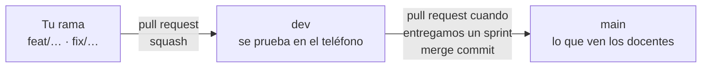

# Cómo contribuir a Sleeve

## Ramas

| Rama | Qué es | Quién la usa |
|---|---|---|
| `main` | Lo entregado al cierre de cada sprint | Los docentes: es la rama que se abre con el link del repo |
| `dev` | Lo que está listo para probar | El equipo, con Expo Go y el backend local |
| Tu rama | Un cambio en curso | Nadie más: solo se revisa |

- **Nadie sube directo a `dev` ni a `main`:** todo entra por pull request.
- Cada cambio va en su propia rama, **salida de `dev`**, con un nombre corto que diga qué es:
  - `feat/…` para funcionalidad nueva (`feat/registro-usuarios`)
  - `fix/…` para arreglos (`fix/error-discogs-502`)
  - `data/…` para los discos de la demo (`data/sumar-edicion`)
  - `docs/…` para el README y la documentación (`docs/readme-backend`)
  - `chore/…` para configuración y dependencias (`chore/expo-sdk-58`)
- Las ramas se borran después de fusionarlas (`dev` y `main` nunca).

## Pull requests

**De tu rama a `dev`** (el día a día):
1. Abrir el pull request **contra `dev`**, contando qué cambia y cómo se probó.
2. **El otro desarrollador lo revisa y lo aprueba.** Nadie fusiona su propio pull request sin el visto bueno del otro.
3. Fusionar con ***Squash and merge***: cada cambio queda como un solo commit en `dev`. Antes de confirmar, revisar el mensaje que propone GitHub: sin espacios al principio de las líneas, porque si no, `Co-authored-by` no se reconoce.

**De `dev` a `main`** (cuando entregamos un sprint):
1. Abrir el pull request de `dev` contra `main`, con la lista de lo que entra.
2. Esperar el visto bueno del otro.
3. Fusionar con ***Create a merge commit*** (no squash): así `dev` y `main` comparten historia y el próximo pull request no arrastra cambios viejos.

**Un arreglo urgente sobre lo entregado** va igual: rama desde `dev`, pull request a `dev` y, enseguida, de `dev` a `main`.

Un pull request hace una sola cosa. Si toca la app y el backend por motivos distintos, mejor dos.

## Antes de pedir revisión

- Desde la raíz, `npx tsc --noEmit` y `npx expo lint` pasan sin errores.
- Si se tocó `backend/`, desde `backend/`, `npx tsc --noEmit` también pasa.
- Lo nuevo se probó en un teléfono con Expo Go. La cámara y el GPS no andan en el simulador.
- Ningún token ni credencial real fuera de `backend/.env`, que no se sube. Revisar `git diff --cached` antes de cada commit.
- Cada texto nuevo de la app está en castellano y en inglés (`constants/translations.ts`).

## Commits

- En español, con el formato `tipo: descripción`, en presente y en minúscula: *feat: agrega la pantalla de registro*, *fix: un 500 de Discogs responde 502*.
- Tipos: `feat`, `fix`, `data`, `docs`, `chore` y `refactor`, los mismos que los prefijos de las ramas.
- La primera línea, de 72 caracteres como máximo. Si hace falta, el detalle va en el cuerpo.
- Cada uno commitea con su usuario de GitHub.

## Decisiones

Las decisiones técnicas se explican en la descripción del pull request que las introduce: qué se eligió, qué alternativa se descartó y por qué. Las que dependen de lo visto en clase se aclaran ahí, para poder defenderlas en la entrega.
